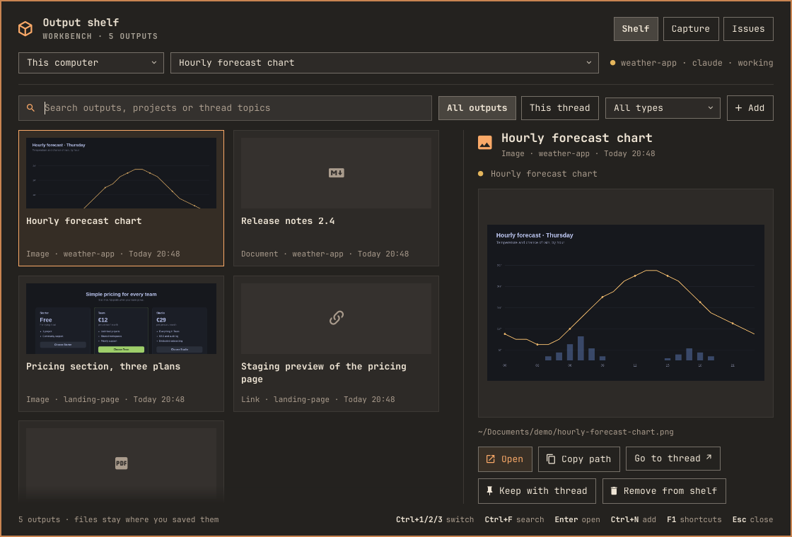

# Workbench

A desk for working with coding agents on [Omarchy](https://omarchy.org). Your agents put what they make on an **output shelf**, you send them notes and screenshots from a **capture** panel, and you hand them GitHub issues from an **issue desk**. Inside [Herdr](https://herdr.dev), a **companion** beside each agent keeps its brief and outputs in view.



Workbench is for people who run Claude Code or Codex in Herdr on Omarchy. Workbench keeps what it stores on your computer and talks to no web service itself, except GitHub (through the GitHub CLI) in the Issues view.

## What you get

- **Output shelf** (Super + Alt + O): every report, image, PDF, page or link your agents finish, searchable and previewed, each linked to the conversation that made it. Files stay where they were saved.
- **Capture** (Super + Alt + C): write a note for an agent, add screenshots, pasted images or files, review it, then send it. If the agent is busy, queue it and it is delivered once the agent is ready. You can also start a new agent conversation from here.
- **Issues** (Super + Alt + I): browse a project's GitHub issues and hand one to Claude or Codex to implement, or describe an idea and let the agent write the issue.
- **Companion** (in Herdr): a narrow pane beside each agent with the agent's own brief (what changed, what's next, what is waiting on you) and the outputs of that conversation.

A few words used throughout:

- A **thread** is one agent conversation running in Herdr.
- An **output** is a finished file or link an agent made (or one you added).
- A **brief** is the short status the agent keeps up to date for its thread.

Agents add outputs and keep briefs because setup gives them standing instructions to do so. Nothing runs in the background to summarize conversations.

## Install

You need:

- Omarchy 4 (Quattro).
- [Herdr](https://herdr.dev) 0.8.2 or later, with Claude Code and/or Codex. The shelf works without Herdr; threads, captures, issue handoffs and the companion need it.
- Optional: the GitHub CLI (`gh`, signed in with `gh auth login`) for the Issues view, `voxtype` for dictation, and `pdftoppm` (poppler) for PDF previews. Setup lists anything missing.

Install the Omarchy plugin, then run its setup:

```sh
omarchy plugin add https://github.com/VulpesZerda27/omarchy-workbench.git --enable
python3 ~/.config/omarchy/plugins/io.github.vulpeszerda27.workbench/workbench.py setup
```

Omarchy only downloads plugins, so setup adds the rest. It shows each change and asks before making it:

- **Command:** `~/.local/bin/workbench`, which the key bindings, menu and agents call.
- **Key bindings** in `~/.config/hypr/bindings.lua`: Super + Alt + O, C, I and Super + Alt + Print. None of them overlap Omarchy's own, and a key you have already bound is left alone.
- **Print key (optional, off by default):** lets Print add its screenshot to an open capture. This replaces Omarchy's Print binding; when no capture is open, Print still takes Omarchy's usual screenshot.
- **Omarchy menu:** a Workbench section in `~/.config/omarchy/extensions/omarchy-menu.jsonc`.
- **Agent instructions** in `~/.claude/CLAUDE.md` and `~/.codex/AGENTS.md`: put finished outputs on the shelf, and keep each thread's brief current. You can read them first in [agent-instructions.md](agent-instructions.md). Without them the shelf and companion stay empty.
- **Herdr companion:** links the companion to the same plugin folder, so both halves always run the same version, and binds it to your Herdr prefix, then **i**.

Each change is a marked block in the file, and the previous version of every file setup edits is kept beside it as a `.bak` copy. You can run `workbench setup` again at any time: it shows what is already in place and only offers what is missing. `workbench setup --dry-run` shows the changes without making them.

Found Workbench in Herdr's plugin list? Install it through Omarchy as above; setup links the Herdr half for you.

## First steps

1. Start a Claude Code or Codex conversation in Herdr. The companion opens beside it. A conversation that was already running before setup needs one reminder to read its Workbench instructions, or start a new one.
2. Ask the agent for something with a result, such as "write a short summary of this project as a Markdown file". When it's done, the file appears in the companion under **Open** and on the shelf (**Super + Alt + O**).
3. Press **Super + Alt + Print**, select part of the screen, add a note and press **Ctrl + Enter** to send it to that agent.
4. In a project with a GitHub repository, press **Super + Alt + I**, pick an issue and hand it to Claude or Codex.

Press **F1** in any panel for its keyboard shortcuts.

| Open | Shortcut |
| --- | --- |
| Output shelf | **Super + Alt + O** |
| Capture | **Super + Alt + C** |
| GitHub issues | **Super + Alt + I** |
| Screenshot into a capture | **Super + Alt + Print** |
| Companion | Herdr prefix, then **i** |

Workbench is also in the Omarchy menu and has an icon for the bar. **Super + Alt + Print** adds its screenshot to the capture or issue request open in Workbench; otherwise it adds it to the focused thread's draft, or starts one. If you opted in to the Print key, Print does the same while a capture is open. The hints in each panel name the key you have.

Workbench takes focus when opened, with the search field or note ready to type in, and keeps it while the mouse moves elsewhere. Click another window to work there: the click goes through and Workbench stays open with your draft. Click back to continue, or press its shortcut again. Its shortcuts only work while Workbench has focus. While Workbench has focus, other windows don't react to hover or scrolling until you click one, and the first click on the window you came from only returns focus to it.

## Update and remove

```sh
omarchy plugin update io.github.vulpeszerda27.workbench
```

This updates both halves, since the companion runs from the same folder; its background worker restarts on the new version by itself. If the panel looks unchanged afterwards, run `omarchy restart shell`.

To remove Workbench:

```sh
workbench remove
omarchy plugin remove io.github.vulpeszerda27.workbench
```

`workbench remove` asks first, then takes out everything setup added and unlinks the Herdr companion. Your outputs list, notes and drafts stay in `~/.local/share/omarchy/workbench/`; delete that folder to remove them too.

## Troubleshooting

- **The shelf and companion stay empty.** Agents add outputs only when they have read their instructions. Start a new conversation, or ask the running one to read `~/.claude/CLAUDE.md` (Claude Code) or `~/.codex/AGENTS.md` (Codex). Run `workbench setup` if the instructions were skipped. You can also add files yourself with **Add**.
- **"Herdr is not running."** Start Herdr with `herdr`; threads appear the next time you open Workbench.
- **No companion beside an agent.** Press your Herdr prefix, then **i**. Closing a companion keeps it hidden for that thread until you open it again this way. If none open at all, check that `herdr plugin list` shows Workbench Companion as enabled, then run `herdr plugin action invoke io.github.vulpeszerda27.workbench-companion.start-automation`.
- **A shortcut does nothing.** Setup leaves keys you had already bound alone and says so. Run `workbench setup` to see which bindings are in place, and `hyprctl configerrors` to check for config errors.
- **The Issues view asks you to sign in.** Run `gh auth login` in a terminal.
- **A project is missing from Issues or New thread.** Projects are the folders in `~/Projects`; a project needs a GitHub remote to show issues.

## Companion

The companion opens automatically to the right of each local agent conversation, including new Codex and Claude threads, without moving keyboard focus. It stays with its thread as you switch between threads. Your Herdr prefix, then **i**, focuses it; pressing that again while it is focused closes it, and it stays hidden for that thread until you open it again the same way. Herdr's pane keys (**prefix, then h / l** by default) also move between the agent and its companion. The selected row highlights only while the companion has focus, and your selection is kept for the next visit.

The **Thread brief** is written by the agent: what changed, the next step, and anything waiting on you, with who updated it and when. Anything waiting on you is marked with a red dot. The agent instructions ask for updates at meaningful milestones and before handing work back; nothing summarizes the conversation in the background.

At the top are the project, agent and status, with Herdr's status dot: yellow while working, red when blocked, green when done (filled) or idle (hollow). Under **Open** are the thread's outputs, newest first, then references you pinned; each row shows its type, link host or age. A moved or deleted original is marked *missing*. Results of actions are confirmed with ✓ or reported with ×.

If you use Herdr's Auto Title plugin, set `HERDR_AUTO_TITLE_PREFER_AGENT=true` in `~/.config/herdr-auto-title/config.env` so focusing the companion keeps the agent's tab title.

- **o — Outputs & previews:** files and links produced in this thread, like **Super + Alt + O** on the desktop.
- **c — Send a note or screenshot:** opens a draft for this agent, reviewed before sending, like **Super + Alt + C**.
- **↑/↓**, then **Enter**, opens an output, pinned reference or general action; clicking works too. Longer lists scroll to keep the selection visible.
- **Enter/click** opens the system's default app, including Omawrite for Markdown. Source files open in your chosen Omarchy editor; executable apps and launchers reveal their containing folder.
- **p** previews the selected item: text opens inside the companion, while images, PDFs and other formats open their preview on the shelf. Use **↑/↓** or **Page Up/Down** to read text, then **Esc** to return.
- **b** reads the full brief. **?** explains the panel and its optional actions.
- **Tab** returns to the agent. **q** closes the companion.

Optional actions under **?**: **e** keeps your own personal note, separate from the agent's brief; **a** pins a reference; **d** removes the selected reference without deleting the original. Personal notes autosave and survive agent updates.

Agents update a clearly identified thread with:

```sh
workbench brief --thread ID --summary "What changed" --next "What happens next"
```

Add `--waiting "Decision needed"` only for a real user decision or action. Brief updates replace old status and never infer a thread from focus or inherited environment variables.

## Output shelf

Search outputs by title, project or thread topic. Toggle **All outputs / This thread**, filter by type, and select a card to preview it. Images and the first page of PDFs have previews; Markdown renders in the current theme. Web pages and links show where they lead and open in your browser. Files whose original has moved are marked **Missing**. **Open** uses the normal app for the file. **Keep with thread** also pins it in the selected companion.

Workbench steps aside while something it opened is on screen: as soon as the app's window appears, the panel hides with everything kept as it was, and it returns with focus when you close that window. A link that opens as a tab in an existing browser window has no window of its own to wait for, so Workbench stays aside until you press **Super + Alt + O** again. If an app can't be opened, Workbench stays and shows why.

The selected thread's status appears beside the thread picker with the same dot as Herdr's sidebar.

Files open with your desktop's default apps, so changing an association also applies here. Opening errors are shown in the companion or shelf. When a file opens in VS Code, it gets a fresh window containing that file. This applies to the standard VS Code desktop handler and to VS Code chosen as the Omarchy editor; custom desktop launch commands keep their own behavior.

Apps open on your desktop even when Herdr was started over SSH.

Use **Add** for links and paths, or **Browse** for files. Removing something from the shelf never deletes the original.

**Ctrl+F** searches; **↓** enters the card grid, then use arrow keys to preview outputs and **Enter** to open one. **Ctrl+O** opens the file picker in either panel. **Ctrl+1 / Ctrl+2 / Ctrl+3** switch to Shelf, Capture and Issues, and **Ctrl+Tab / Ctrl+Shift+Tab** step through them; **Ctrl+N** adds an output or starts a capture draft. **Tab / Shift+Tab** move between controls, including out of the note editor. **Esc** backs out of a menu or file picker first, then closes Workbench. **F1** shows the shortcut reminder.

In the file picker, **Ctrl+L** selects the path, **Alt+Up** opens the parent folder, and **Ctrl+H** shows hidden files. Use arrows, **Home/End**, and **Enter** to navigate; closing it restores your previous keyboard focus. Sort by name, date modified, type or size by clicking a column heading; click it again to reverse the order. **Ctrl+S** moves to the next column and **Ctrl+R** reverses. Dates and sizes start newest or largest first, folders stay above files, and the picker remembers your choice in the Shelf, Capture and Issues.

Agents register finished outputs using:

```sh
workbench add /absolute/path/to/report.md --title "Research brief"
workbench add https://example.com/preview --title "Preview"
```

`workbench threads` lists the available identities; use `--thread ID` for a known conversation (or an explicitly known `--pane`). Shared agent processes can inherit an old pane identity, so environment variables are never used for this association. Otherwise an output stays unassigned and appears under **All outputs**. Focus never determines automatic registration.

## Capture

Choose the destination at the top, then write a note or paste a link. The hints above the note show the screenshot key and Ctrl+O; paste and dictation work as they do everywhere:

- **Super + Alt + Print** (or Print, if you opted in) steps the panel aside for Omarchy's own screenshot picker, then returns to the draft with the screenshot attached.
- **Ctrl+V** pastes text as usual; a copied image (with no text alongside it) is added as an attachment.
- **Ctrl+O** attaches a file.
- **Super + Ctrl + X** is Omarchy's dictation (with voxtype installed), which types into the note like a keyboard; it never types into an agent prompt while Workbench has focus.

A capture can hold several attachments: each screenshot, pasted image or attached file adds one, and each can be opened or removed on its own. The first message lists every file.

To start a new thread instead, switch the destination to **New thread** (**Ctrl+T**). Choose a project (every folder in `~/Projects`, most recently active first, with the thread you came from preselected) and Claude or Codex (Claude by default), then **Start thread**. The agent starts in a fresh Herdr workspace for the project, without switching Herdr away from what you're doing, and your note becomes its first message once it's ready. Its companion opens beside it. Workbench stays open; **Go to thread ↗** takes you there. New threads start on this computer.

Drafts save automatically; **Esc** closes the panel and keeps your draft. Reopen a saved draft from the draft picker, or **Discard** an unwanted draft. **Send to thread** (or **Ctrl+Enter**, including from the editor) submits the reviewed text and the attachment paths. An image-capable agent can open those reference files with its usual image tools. Screenshots are kept in Workbench's private folder rather than `~/Pictures`.

While the agent is busy, the button becomes **Queue for thread**. Clicking it saves your reviewed capture for automatic delivery when that agent becomes ready. You can close the panel; **Cancel queue** makes the draft editable again. The queue waits through approval dialogs and never answers them. If the original conversation closes or changes, delivery stops and the draft remains saved with an explanation. If a connection fails after submission, the draft is marked for a delivery check and will not be retried automatically.

## Issues

Pick a project at the top: every folder in `~/Projects`, most recently active first (a repository's last commit counts as activity), found each time. Its GitHub repository comes from the project's git remote (the one `gh repo set-default` chose, otherwise `origin`), so new projects need no setup. A project without a GitHub remote says so instead of showing issues. The project you came from is preselected when it is on GitHub; otherwise the last project you picked.

The left side lists the repository's **Open** or **Closed** issues with their labels; search by title, number, label or author. Select one to read it with its comments on the right. Images in issues appear as links, so nothing is loaded from the web until you open it. **Ctrl+R** or the refresh button fetches the latest list; an open Issues view also refreshes every minute. If GitHub can't be reached, the last list stays visible with a note. Issues are read with the GitHub CLI (`gh`), using its existing sign-in.

**Hand to Claude / Codex** at the top chooses the agent. Every handoff starts that agent in a fresh Herdr workspace for the project, without switching Herdr away from what you're doing. The request becomes the agent's first message once it's ready, through the same reviewed queue as Capture.

- **Implement an issue:** select it, optionally add instructions (a preferred approach, limits, what to test), then **Implement with Claude** (**Ctrl+Enter**). The agent reads the issue and its comments with `gh`, checks them against the code, follows the project's own agent instructions for branches, tests and commits, and asks before deciding anything the issue leaves open.
- **Write a new issue:** **New issue** (**Ctrl+N**), describe it in your own words, then **Write issue with Claude**. The agent reads the code, checks for an existing issue first, then files a complete one (problem, findings, proposed approach, acceptance criteria) with the repository's templates and existing labels, and replies with the link. It changes no code.

The screenshot key, **Ctrl+V** with a copied image and **Ctrl+O** add screenshots and files to either request, as in Capture. Instructions and descriptions save as you type, per issue, and survive closing the panel; **Clear** or **Discard** removes them.

While an agent works on an issue, its row shows the agent and Herdr's status dot, and the issue says what the agent is doing (working, needs your approval, waiting for you) with **Go to thread ↗**. New issues still being written appear above the list, and the list refreshes when their agent stops so the new issue shows up.

## Themes

Workbench follows your Omarchy theme, light or dark, including `shell.toml` overrides and `omarchy display text size`. The companion uses your terminal's palette and the theme's accent and selection colours; status dots use the same greens, yellows and reds as Herdr.

## Data and privacy

Notes, references, the list of outputs, capture drafts, issue requests, screenshots and a cache of fetched issues are stored in `~/.local/share/omarchy/workbench/`, in a folder only you can read. Output files stay where they were saved; Workbench only keeps their paths. Nothing talks to a web service except the GitHub CLI in the Issues view.

Remote Herdr machines are experimental: the panels can pick a saved machine and send it a capture (a screenshot is copied over its existing SSH profile), but the companion only runs on this computer.

## Development

```sh
python3 -m unittest discover -s tests -v
omarchy plugin validate .
herdr config check
```

To work on a clone, link it in place of an installed copy, then run setup from it:

```sh
ln -s ~/path/to/omarchy-workbench ~/.config/omarchy/plugins/io.github.vulpeszerda27.workbench
omarchy-shell shell rescanPlugins && omarchy plugin enable io.github.vulpeszerda27.workbench
python3 workbench.py setup
```

The Omarchy plugin is `io.github.vulpeszerda27.workbench`; the Herdr plugin is `io.github.vulpeszerda27.workbench-companion`. The Herdr plugin's startup hook runs a local worker that checks for new threads and reviewed queued captures every two seconds. It stops when Herdr stops or the plugin is disabled. After linking or re-enabling it in a running Herdr session, start it with `herdr plugin action invoke io.github.vulpeszerda27.workbench-companion.start-automation` (setup does this for you).

It needs only Python's standard library. `workbench --help` lists the command-line options. Release notes for maintainers are in [docs/publishing.md](docs/publishing.md).

Agent instruction locations follow the [OpenAI documentation](https://learn.chatgpt.com/docs/agent-configuration/agents-md) and [Claude Code documentation](https://code.claude.com/docs/en/memory).

## License

[MIT](LICENSE)
